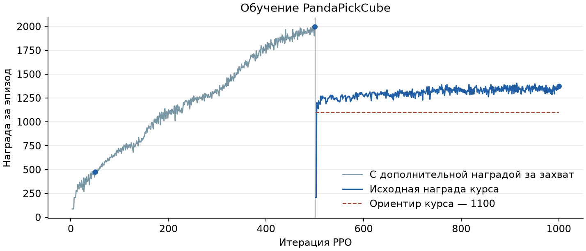
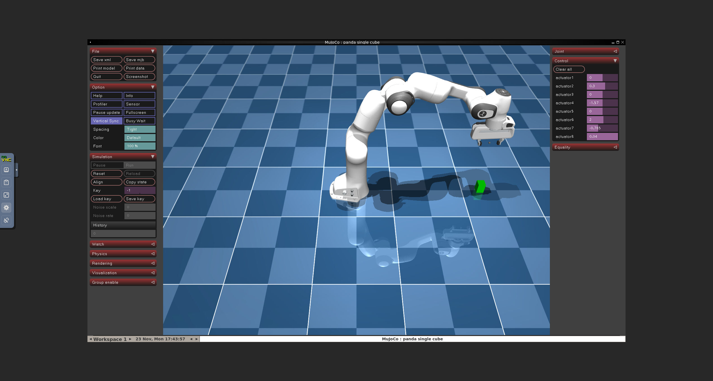

# Практика 1 Physical AI — обучение Franka Emika Panda

Финальная политика подняла куб и доставила его к цели в **10 из 10** базовых эпизодов. Смещение куба и шум снизили число подъёмов до **5 из 10**. Средняя награда обучения на последней итерации составила **1373,98**.

## Задача

В `PandaPickCube` манипулятор Franka Emika Panda должен захватить куб, поднять его и перенести к цели. На каждом шаге политика получает состояние робота и сцены и выдаёт восемь команд для семи суставов и захвата. Награда учитывает приближение захвата к кубу, положение куба относительно цели, контакт захвата с полом и отклонение суставов от исходной позы. [Репозиторий практики](https://github.com/Yandex-Practicum/ap-physicalai-1) · [Среда PandaPickCube](https://github.com/google-deepmind/mujoco_playground/blob/v0.1.0/mujoco_playground/_src/manipulation/franka_emika_panda/pick.py)

## Обучение

Итоговая модель обучена в Google Colab на NVIDIA Tesla T4 с помощью PPO из RSL-RL и MuJoCo MJX с движком Warp. Обучение заняло 1001 итерацию с 2048 параллельными средами. На итерациях 0–500 политика получала дополнительную награду за закрытие захвата рядом с кубом и за подъём куба. С итерации 501 обучение продолжилось с сохранёнными весами и состоянием оптимизатора по исходной функции награды курса. Для наблюдений актора и критика применялась нормализация.

На итерации 1000 средняя награда по исходной функции составила **1373,98** при ориентире курса **1100**. В итоговом прогоне не было сообщений о переполнении буфера столкновений Warp. В первом прогоне со штатной наградой и 4096 средами средняя награда на последней итерации составила 914,90. Его финальная политика при детерминированной проверке подняла куб в 10 из 10 эпизодов и доставила его к цели в одном. [Документация MuJoCo MJX](https://mujoco.readthedocs.io/en/3.5.0/mjx.html)

Локальная проверка в CPU-контейнере Docker Desktop на macOS ARM завершилась результатом **8 из 8 тестов**. На снимке noVNC видны Panda, куб и панель всех восьми приводов.

## Методика проверки

Чекпоинты `model_50.pt`, `model_500.pt` и `model_1000.pt` сравниваются на трёх одинаковых начальных состояниях с seed 42–44. Для базового прогона и двух экспериментов используется `model_1000.pt` и один набор seed 42–51. В эксперименте с кубом задаётся его начальная позиция по X и Y, а цель продолжает определяться seed. В эксперименте с шумом положение куба выбирается как в базовом прогоне, а в наблюдение на каждом шаге добавляется независимый гауссовский шум с нулевым средним и заданным стандартным отклонением.

Главная метрика — число эпизодов, в которых куб поднялся более чем на 0,10 м от своего исходного уровня. Доставка к цели засчитывается, когда расстояние между кубом и целью в конце эпизода меньше 0,05 м. Для экспериментов искалось число подъёмов, ближайшее к половине базового результата.

При обучении начальные координаты куба выбирались из диапазонов X от 0,50 до 0,90 м и Y от −0,20 до 0,20 м. В эксперименте со смещением использовались абсолютные координаты за пределами этой области.

## Сравнение чекпоинтов

| Итерация | Подъёмы | Доставки | Средняя награда | Видео |
|---:|---:|---:|---:|---|
| 50 | 0/3 | 0/3 | 555,13 | [video_iter50.mp4](logs/grasp_run/video_iter50.mp4) |
| 500 | 3/3 | 3/3 | 1468,71 | [video_iter500.mp4](logs/grasp_run/video_iter500.mp4) |
| 1000 | 3/3 | 3/3 | 1512,96 | [video.mp4](logs/grasp_run/video.mp4) |

На 50-й итерации захват дотягивался до куба, но все три эпизода закончились без подъёма. К 500-й итерации Panda довела куб до целевой зоны во всех трёх эпизодах. У финальной модели медианная ошибка в конце эпизода уменьшилась с 15 до 8 мм на тех же трёх начальных состояниях. После захвата финальная политика удерживала куб на высоте цели.

## Устойчивость финальной политики

| Условие | Подъёмы | Доставки | Средняя награда | Видео |
|---|---:|---:|---:|---|
| Базовое | 10/10 | 10/10 | 1516,14 | [exp1_indomain.mp4](logs/grasp_run/exp1_indomain.mp4) |
| Позиция X = 0,375 м, Y = 0,2275 м | 5/10 | 1/10 | 486,01 | [exp2_far.mp4](logs/grasp_run/exp2_far.mp4) |
| Шум наблюдений σ = 0,030 | 5/10 | 0/10 | 407,25 | [exp3_noise.mp4](logs/grasp_run/exp3_noise.mp4) |

**Смещение куба.** После 24 пробных прогонов итоговая запись при X = 0,375 м и Y = 0,2275 м дала 5 подъёмов и 1 доставку. При повторе выбранной позиции число подъёмов выросло с 4 до 5 из 10. При переходе от (0,35 м, 0,22 м) к (0,45 м, 0,25 м) результат изменился с 0 до 10 подъёмов из 10. Положение границы зависит от направления смещения и достижимости куба для захвата.

**Шум наблюдений.** При σ = 0,020 поднять куб удалось в 7 из 10 эпизодов, при σ = 0,050 — в одном, при σ = 0,100 — ни в одном. Для σ = 0,029375 три прогона дали 5, 3 и 4 подъёма. После 21 пробного прогона итоговое видео записано при σ = 0,030 прямо из траекторий, по которым получен результат 5 из 10. К концу всех пяти эпизодов с подъёмом высота куба снова снизилась ниже порога подъёма. Доставок при этом уровне шума не было.

## Выводы

Параллельные среды на GPU позволили собирать траектории для PPO в 2048 копиях симуляции. Смещение и шум показали, что надёжность подъёма и надёжность доставки расходятся: робот может успешно поднять куб и потерять его по пути.

Для переноса на реального робота важно измерить шум и задержки сенсоров, а затем проверить доставку в симуляции с этими искажениями. Рандомизация стартовых позиций, сенсорного шума и физических параметров во время обучения позволяет проверить, расширяется ли область устойчивой работы. Оценки в этом отчёте описывают конкретные 10 начальных состояний и параметры, подобранные на них.

## Приложения и воспроизведение

- [Таблица всех 51 прогонов](logs/grasp_run/evaluation.csv) и [метрики по каждому эпизоду](logs/grasp_run/episodes.csv).
- [Средняя награда по итерациям](logs/grasp_run/training_rewards.csv) и [конфигурация вычислительной среды](logs/grasp_run/training_environment.json).
- В архиве есть 21 чекпоинт, конфигурации обеих фаз и журнал TensorBoard.

Для обучения использовался скрипт `run_grasp.sh` с Python 3.13, MuJoCo и MJX 3.5.0, JAX 0.6.2 (CUDA 12), Warp 1.11.0, MuJoCo Playground 0.1.0, PyTorch 2.13.0 и RSL-RL 5.5.2. Сценарий `evaluate_practice.py` запускает сравнительные и экспериментальные прогоны, а `refine_noise.py` сохраняет итоговое видео из траекторий, использованных для подсчёта подъёмов.

### Пробные позиции куба

| Попытка | X, м | Y, м | Подъёмы | Доставки | Средняя награда |
|---:|---:|---:|---:|---:|---:|
| 1 | 0,15 | 0,1 | 0/10 | 0/10 | 143,22 |
| 2 | 0,25 | 0,15 | 0/10 | 0/10 | 246,90 |
| 3 | 0,28 | 0,15 | 1/10 | 0/10 | 289,62 |
| 4 | 0,295 | 0,15 | 0/10 | 0/10 | 267,73 |
| 5 | 0,35 | 0,22 | 0/10 | 0/10 | 334,91 |
| 6 | 0,45 | 0,25 | 10/10 | 10/10 | 1453,63 |
| 7 | 0,55 | 0,3 | 10/10 | 8/10 | 1133,56 |
| 8 | 0,65 | 0,35 | 10/10 | 10/10 | 1372,81 |
| 9 | 0,75 | 0,4 | 10/10 | 10/10 | 1249,61 |
| 10 | 0,85 | 0,45 | 0/10 | 0/10 | 313,36 |
| 11 | 0,35 | 0,35 | 7/10 | 2/10 | 517,90 |
| 12 | 0,45 | 0,4 | 10/10 | 7/10 | 1010,70 |
| 13 | 0,48 | 0,12 | 10/10 | 10/10 | 1510,77 |
| 14 | 0,49 | 0,16 | 10/10 | 10/10 | 1454,76 |
| 15 | 0,55 | 0,45 | 10/10 | 10/10 | 1139,00 |
| 16 | 0,65 | -0,22 | 10/10 | 10/10 | 1499,51 |
| 17 | 0,55 | -0,25 | 10/10 | 9/10 | 1291,66 |
| 18 | 0,45 | -0,3 | 7/10 | 2/10 | 387,70 |
| 19 | 0,93 | 0,1 | 0/10 | 0/10 | 395,26 |
| 20 | 0,4 | 0,235 | 10/10 | 5/10 | 854,47 |
| 21 | 0,375 | 0,2275 | 4/10 | 1/10 | 465,26 |
| 22 | 0,3875 | 0,23125 | 4/10 | 2/10 | 635,20 |
| 23 | 0,39375 | 0,233125 | 9/10 | 5/10 | 826,74 |
| 24 | 0,390625 | 0,232187 | 6/10 | 2/10 | 609,66 |

### Пробные уровни шума

| Попытка | σ | Подъёмы | Доставки | Средняя награда |
|---:|---:|---:|---:|---:|
| 1 | 0,02 | 7/10 | 0/10 | 476,06 |
| 2 | 0,05 | 1/10 | 0/10 | 360,02 |
| 3 | 0,1 | 0/10 | 0/10 | 334,04 |
| 4 | 0,2 | 0/10 | 0/10 | 255,14 |
| 5 | 0,3 | 0/10 | 0/10 | 208,24 |
| 6 | 0,4 | 0/10 | 0/10 | 170,92 |
| 7 | 0,6 | 0/10 | 0/10 | 130,87 |
| 8 | 0,8 | 0/10 | 0/10 | 112,33 |
| 9 | 1 | 0/10 | 0/10 | 106,43 |
| 10 | 0,035 | 1/10 | 0/10 | 407,40 |
| 11 | 0,0275 | 6/10 | 0/10 | 446,76 |
| 12 | 0,03125 | 2/10 | 0/10 | 372,09 |
| 13 | 0,029375 | 5/10 | 0/10 | 411,68 |
| 14 | 0,029375 | 3/10 | 0/10 | 385,07 |
| 15 | 0,028 | 3/10 | 0/10 | 374,96 |
| 16 | 0,0285 | 4/10 | 0/10 | 377,60 |
| 17 | 0,029 | 4/10 | 0/10 | 427,62 |
| 18 | 0,029375 | 4/10 | 0/10 | 398,42 |
| 19 | 0,0275 | 6/10 | 0/10 | 418,28 |
| 20 | 0,02975 | 3/10 | 0/10 | 433,23 |
| 21 | 0,027 | 2/10 | 0/10 | 415,79 |
