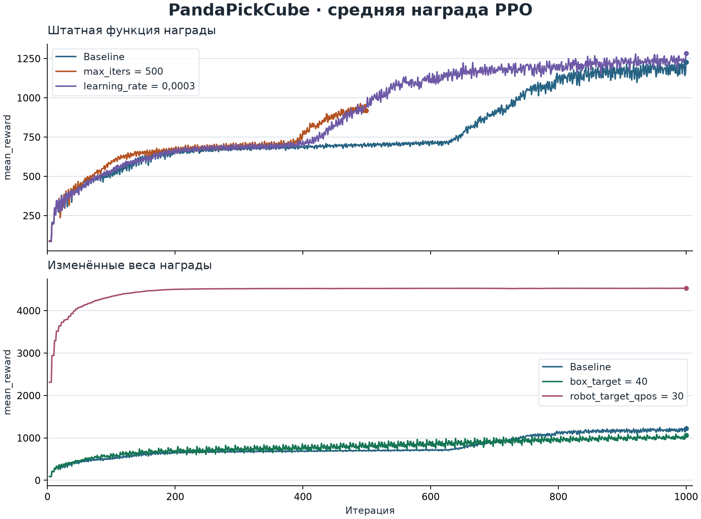

# Практика 2 Physical AI · Эксперименты с PPO

## Постановка

Franka Emika Panda в среде `PandaPickCube` должен поднять куб и перенести его к заданной точке. Baseline и ещё четыре политики обучены с нуля. В каждом эксперименте менялась одна настройка baseline. Для всех запусков использовались 4096 параллельных сред, seed обучения 1 и Google Colab с NVIDIA Tesla T4. Симуляция работала на MuJoCo MJX Warp с ёмкостью буфера CCD 32768. [Исходники Практикума](https://github.com/Yandex-Practicum/ap-physicalai-1/tree/70ea0fe0e039846126bd0f87f38738b710a0d515)

Начальные настройки `num_envs=4096`, `max_iters=1001`, `learning_rate=0.001` и `gripper_box=4.0` указаны в [заполненном шаблоне Excel](find-the-parameters.xlsx) вместе с путями к этим параметрам в коде. Значение 4096 относится к CUDA. В исходном `device_utils.py` для CPU и MPS используется 64. [Шаблон задания](https://disk.yandex.ru/d/-tkuNHCkF3E-6A)

В исходной среде `box_target` учитывает положение и ориентацию куба относительно цели. Этот компонент включается после первого сближения точки захвата и центра куба на расстояние менее 1,2 см. Компонент `robot_target_qpos` начисляет больше награды, когда суставы руки остаются ближе к начальной позе.

## Методика проверки

`mean_reward` взят из последней итерации обучения из лога RSL-RL. Колонка «Время» показывает длительность вызова `runner.learn` по логу `train.py` и включает JIT-компиляцию во время этого вызова. Для отчёта сопоставлены финальные чекпоинты `model_1000.pt` и `model_499.pt` у запуска с 500 итерациями.

Детерминированные политики проверены на одинаковых стартовых состояниях с seed 42–51. Наблюдения подавались напрямую из штатной среды. Успех засчитывается, когда в последнем состоянии эпизода евклидово расстояние от центра куба до цели строго меньше 5 см. SR показывает число таких эпизодов из десяти.

Сближение в таблице означает, что минимальное расстояние между точкой захвата и центром куба было меньше 3 см. Подъём засчитывается при увеличении высоты куба более чем на 10 см от старта. Для эпизодов с подъёмом отдельно посчитано, сколько раз итоговая высота вернулась в диапазон до 10 см над стартом. Во всех пяти видео показан один заранее выбранный общий seed 42.

## Сравнение запусков

| Эксперимент | Изменения в коде | Команда запуска | mean_reward | SR (k/10) | Время | Поведение |
|---|---|---|---:|---:|---:|---|
| Baseline | Штатная конфигурация | | 1226,01 | 8/10 | 28 мин 42 с | Сближение 10/10, подъём 10/10, снижение после подъёма 0/10. [Видео](results/clips/baseline_seed42.mp4) |
| Масштаб | `max_iters` с 1001 до 500 | | 918,63 | 2/10 | 14 мин 23 с | Сближение 10/10, подъём 10/10, снижение после подъёма 0/10. [Видео](results/clips/max_iters_500_seed42.mp4) |
| Усиленная цель | `box_target` с 8,0 до 40,0 | | 1057,55 | 0/10 | 28 мин 03 с | Сближение 10/10, подъём 0/10, снижение после подъёма 0/10. [Видео](results/clips/box_target_strong_seed42.mp4) |
| Усиленная поза | `robot_target_qpos` с 0,3 до 30,0 | | 4527,50 | 0/10 | 27 мин 04 с | Сближение 0/10, подъём 0/10, снижение после подъёма 0/10. [Видео](results/clips/qpos_strong_seed42.mp4) |
| Самостоятельный эксперимент | Начальный `learning_rate` с 0,001 до 0,0003 | | 1282,76 | 9/10 | 30 мин 07 с | Сближение 10/10, подъём 10/10, снижение после подъёма 0/10. [Видео](results/clips/learning_rate_3e_minus4_seed42.mp4) |

## Что изменилось относительно baseline

| Эксперимент | Δmean_reward | ΔSR, п. п. | Медиана ошибки в конце, см |
|---|---:|---:|---:|
| Baseline | +0,00 | +0 | 2,2 |
| Масштаб | -307,38 | -60 | 10,7 |
| Усиленная цель | -168,46 | -80 | 38,5 |
| Усиленная поза | +3301,49 | -80 | 38,5 |
| Самостоятельный эксперимент | +56,75 | +10 | 1,3 |



Сокращение бюджета до 500 итераций почти вдвое уменьшило время обучения и снизило SR на 60 п. п. На видео для seed 42 эта политика подняла куб выше цели и закончила эпизод на расстоянии 16,3 см от неё. Увеличение любого из двух весов дало наибольшее падение SR среди проверенных изменений, на 80 п. п. При `box_target=40` Panda добиралась до куба во всех эпизодах, а его высота оставалась в пределах порога подъёма 10 см. При `robot_target_qpos=30` рука на видео оставалась около начальной позы, а тренировочная награда быстро вышла на плато около 4500. Изменение веса меняет численную шкалу тренировочной награды, поэтому для сравнения качества доставки используется единый SR.

## Самостоятельный эксперимент

До запуска серии была записана [гипотеза](hypothesis.md) о том, что при начальном `learning_rate=0.0003` кривая будет расти медленнее, финальная награда уменьшится, а SR окажется не выше baseline. PPO использовал адаптивное расписание в обоих запусках, поэтому изменение касалось начального значения.

Оба прогноза о финальных метриках в этом прогоне опровергнуты. Модель с меньшим начальным шагом получила **1282,76** по `mean_reward` против 1226,01 у baseline и доставила куб в **9 из 10** эпизодов против 8 из 10. Средняя награда за итерации 500–749 достигла 1121,98 против 786,93 у baseline. Это соответствует более раннему выходу с плато на графике. Разница в SR составляет одну доставку на десяти общих начальных состояниях. На каждую конфигурацию пришёлся один запуск обучения, поэтому вывод относится к этой серии.

## Материалы и воспроизведение

- [Метрики по 50 эпизодам](results/episodes.csv), [сводка экспериментов](results/experiments.csv), [кривые обучения в CSV](results/training_curves.csv) и [версии библиотек](results/environment.json).
- [Конфигурация пяти запусков](train_experiment.py), [скрипт обучения](run_training.sh) и [скрипт оценки](evaluate_and_package.py).
- Полный архив содержит также финальные чекпоинты, журналы консоли, события TensorBoard, сохранённые конфигурации и три файла из `support/`, использованные при запуске и оценке.

Эксперименты выполнены в Colab с Python 3.13.16 и CUDA. Версии PyTorch, JAX, MuJoCo, MJX, Playground, RSL-RL и Warp записаны в `results/environment.json`. Для повтора разместите исходники Практикума указанного коммита в `/content/ap-physicalai-1` и скопируйте туда файлы из `support/`. В новый каталог `/content/physical-ai-practice-2` скопируйте `train_experiment.py`, `run_training.sh`, `evaluate_and_package.py`, `hypothesis.md` и `hypothesis-timestamp.txt`.

```bash
cd /content/physical-ai-practice-2
set -euo pipefail
bash run_training.sh | tee suite.log
export PYTHONPATH=/content/ap-physicalai-1
export LD_LIBRARY_PATH=/usr/lib64-nvidia JAX_PLATFORMS=cuda
export XLA_PYTHON_CLIENT_PREALLOCATE=false MUJOCO_GL=egl LP_NUM_THREADS=2
python3 -u evaluate_and_package.py
```

Для просмотра событий TensorBoard можно передать каталог `logs` из архива через `tensorboard --logdir logs`. График в отчёте показывает логируемый `Train/mean_reward` с точностью консольного вывода.
